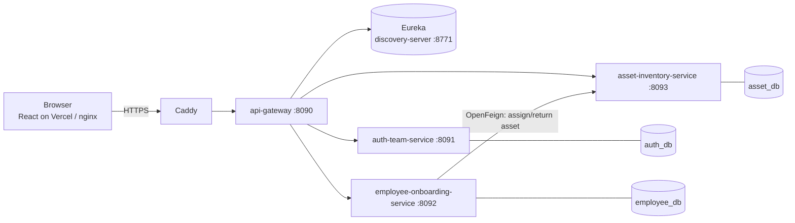

# OnboardHub

A role-based employee onboarding and asset tracker that gives HR and IT one shared checklist, inventory, and assignment history.

## The problem

Onboarding tasks and equipment assignments often live in separate spreadsheets. This makes it hard to see progress and risks duplicate asset allocation. OnboardHub centralizes the workflow and makes asset assignment atomic.

## How it works

1. HR creates an employee record with department, job title, joining date, and required equipment.
2. The employee service generates a checklist with HR tasks, IT setup tasks, equipment tasks, owners, and due dates.
3. IT adds company assets to inventory and tracks their status.
4. IT assigns an available asset of the matching type to an equipment task; an atomic update prevents two assignments of the same asset.
5. HR and IT track task ownership, due dates, and progress; the employee becomes active when every task is done.
6. Employees sign in to view their own checklist and issued equipment, while HR and IT dashboards show onboarding progress and asset stock.

## Roles and permissions

| Role | Main permissions |
| :--- | :--- |
| `ADMIN` | Creates team accounts; can perform HR and IT actions. |
| `HR` | Creates and updates employees, completes HR-owned tasks, and reads assets and dashboards. |
| `IT` | Manages assets, assigns and returns equipment, completes IT-owned tasks, and reads employee records and dashboards. |
| `EMPLOYEE` | Reads only their own onboarding record and equipment. |

## Architecture



| Service | Port | Database | Responsibility |
| :--- | :--- | :--- | :--- |
| `discovery-server` | 8771 | — | Eureka service registry. |
| `api-gateway` | 8090 | — | Single entry point, routing, and CORS; forwards authorization headers. |
| `auth-team-service` | 8091 | `auth_db` | Registration, login, JWT issuing, team users, and bootstrap admin. |
| `employee-onboarding-service` | 8092 | `employee_db` | Employee records, generated checklists, tasks, and onboarding dashboard. |
| `asset-inventory-service` | 8093 | `asset_db` | Inventory, asset assignment and return, history, and stock summary. |
| `frontend` (nginx) | 3001 | — | React application for local and Compose runs. |

One PostgreSQL server hosts the three service databases. Services register with Eureka, and the gateway routes requests using `lb://` service names. The employee service calls the asset service through OpenFeign for assignment and return.

## Tech stack

- Backend: Java 17, Spring Boot 3.2.12, Spring Cloud 2023.0.6, Spring Security, JWT, OpenFeign, Springdoc OpenAPI, JUnit 5, Mockito.
- Data: PostgreSQL 16 in Compose; H2 for automated tests.
- Frontend: React 18, Vite 5, Tailwind CSS 3.4, React Router 6, Axios, Vitest, Testing Library.
- Delivery: Docker, Docker Compose, GitHub Actions, Docker Hub; planned hosting on AWS EC2 and Vercel.

## Project structure

```text
backend/
  discovery-server/
  api-gateway/
  auth-team-service/
  employee-onboarding-service/
  asset-inventory-service/
frontend/
docker/
postman/
scripts/
.github/workflows/
docs/
```

## Quick start with Docker Compose

Prerequisites: Docker Desktop with Compose v2 and at least 4 GB memory available. From the repository root, copy the example environment and replace every placeholder with local values. Use a JWT secret of at least 32 characters and set the bootstrap administrator credentials; keep `docker/.env` private and uncommitted.

```powershell
Copy-Item docker/.env.example docker/.env
```

The documented staged start from [docker/README.md](docker/README.md) is:

```powershell
$compose = @('-f', 'docker/docker-compose.yml', '--env-file', 'docker/.env')
function Wait-OnboardHubHealthy([string[]]$Services) {
  $deadline = (Get-Date).AddMinutes(5)
  do {
    $states = @($Services | ForEach-Object {
      docker inspect --format='{{.State.Health.Status}}' "onboardhub-$_-1" 2>$null
    })
    if ($states.Count -eq $Services.Count -and @($states | Where-Object { $_ -ne 'healthy' }).Count -eq 0) { return }
    if ((Get-Date) -ge $deadline) { throw "Timed out waiting for healthy services: $($Services -join ', ')" }
    Start-Sleep -Seconds 5
  } while ($true)
}

docker compose @compose up -d postgres discovery-server
Wait-OnboardHubHealthy @('postgres', 'discovery-server')

docker compose @compose up -d auth-team-service asset-inventory-service employee-onboarding-service
Wait-OnboardHubHealthy @('auth-team-service', 'asset-inventory-service', 'employee-onboarding-service')

docker compose @compose up -d api-gateway frontend
```

Other Compose commands (from the repository root):

```powershell
docker compose -f docker/docker-compose.yml --env-file docker/.env ps
docker compose -f docker/docker-compose.yml --env-file docker/.env logs -f <service>
docker compose -f docker/docker-compose.yml --env-file docker/.env stop
docker compose -f docker/docker-compose.yml --env-file docker/.env down
```

| URL | Purpose |
| :--- | :--- |
| http://localhost:3001 | Frontend |
| http://localhost:8090 | API gateway |
| http://localhost:8771 | Eureka dashboard |
| http://localhost:8091/swagger-ui.html | Auth and team Swagger UI |
| http://localhost:8092/swagger-ui.html | Employee onboarding Swagger UI |
| http://localhost:8093/swagger-ui.html | Asset inventory Swagger UI |

## Environment variables

See [docs/10_DEPLOYMENT.md](docs/10_DEPLOYMENT.md#2-environment-variables) and `docker/.env.example`. The table lists purposes, not values.

| Variable | Used by | Purpose |
| :--- | :--- | :--- |
| `POSTGRES_USER`, `POSTGRES_PASSWORD` | Postgres and business services | Database login. |
| `JWT_SECRET`, `JWT_EXPIRATION_MS` | Auth, employee, asset services | Shared JWT signing and validation settings. |
| `CORS_ALLOWED_ORIGINS` | Gateway | Allowed browser origins. |
| `BOOTSTRAP_ADMIN_NAME`, `BOOTSTRAP_ADMIN_EMAIL`, `BOOTSTRAP_ADMIN_PASSWORD` | Auth service | Initial administrator if no admin exists. |
| `EUREKA_URL`, `EUREKA_INSTANCE_PREFER_IP_ADDRESS` | Eureka clients | Service discovery and registration address selection. |
| `DB_URL`, `DB_USERNAME`, `DB_PASSWORD` | Business services | Database connection settings. |
| `JAVA_OPTS` | Java services | JVM options. |
| `VITE_API_BASE_URL` | Frontend build | Gateway URL used by the browser. |
| `DOCKER_USERNAME`, `IMAGE_TAG`, `API_DOMAIN` | Production Compose | Image namespace, image version, and API hostname. |

## API documentation

All APIs are routed through the gateway at `http://localhost:8090`. The OpenAPI contract is in [docs/05_API_CONTRACT.md](docs/05_API_CONTRACT.md); Swagger UI is available at the three business-service URLs above. The importable collection and environment are in [postman/README.md](postman/README.md).

## Testing

Backend modules are standalone Maven projects. Run `mvn -B test` from each `backend/<service>` directory. For a clean workspace, run `mvn -q clean` after each module. In `frontend/`, run `npm ci` when dependencies are absent, then `npm test` and `npm run build`.

The test counts below were collected in this session on local JDK 25.0.4:

| Module | Tests run | Failures | Errors | Skipped |
| :--- | ---: | ---: | ---: | ---: |
| discovery-server | 1 | 0 | 0 | 0 |
| api-gateway | 3 | 0 | 0 | 0 |
| auth-team-service | 33 | 0 | 0 | 0 |
| asset-inventory-service | 28 | 0 | 0 | 0 |
| employee-onboarding-service | 39 | 0 | 0 | 0 |
| frontend | 73 | 0 | 0 | 0 |
| **Total** | **177** | **0** | **0** | **0** |

See [docs/09_TESTING.md](docs/09_TESTING.md) for the test strategy, coverage map, and report.

## CI/CD

The [GitHub Actions workflow](.github/workflows/ci-cd.yml) runs `backend-tests`, `frontend`, `docker-build`, and `compose-smoke`. Compose smoke starts the complete stack, checks health and Eureka registration, exercises the API smoke script, and runs the Newman collection. Images are published to Docker Hub only for pushes to `main`; see [docs/10_DEPLOYMENT.md#3-cicd](docs/10_DEPLOYMENT.md#3-cicd).

## Deployment overview

The planned deployment uses Vercel for the frontend and one AWS EC2 server for backend containers, with Caddy providing HTTPS for a DuckDNS hostname. Deployment details and operations notes are in [docs/10_DEPLOYMENT.md#4-production-aws-ec2--vercel](docs/10_DEPLOYMENT.md#4-production-aws-ec2--vercel). Live deployment is pending.

## Security notes and known limitations

Business services validate JWTs and enforce role permissions; the gateway routes and forwards the `Authorization` header but does not validate JWTs. Passwords are BCrypt-hashed, and the shared signing secret belongs in environment configuration. The frontend stores the session JWT in `localStorage`.

Known limitations: Hibernate uses `ddl-auto=update` rather than migrations; there are no email notifications or file uploads; and the demo server is intended to run one stack at a time. Deployment, browser walkthrough, and load testing remain pending.

## AI-assisted workflow

This project followed a TrainingMug ADF workflow: review project docs, state `ASSUMPTIONS` before implementation, work one module or feature per prompt, run the requested verification loop, and have a human review and commit changes manually. The prompt log is [docs/11_PROMPTS.md](docs/11_PROMPTS.md).

## Live demo

Live URLs are added after deployment.

## Screenshots

No screenshot files currently exist in `docs/screenshots/`.

- [ ] Login
- [ ] Dashboard
- [ ] Employees
- [ ] Employee detail checklist
- [ ] Assign asset modal
- [ ] Assets
- [ ] Team page
- [ ] My onboarding
- [ ] GitHub Actions
- [ ] Docker Hub

## License and author

License: TBD. Author: Project team.
