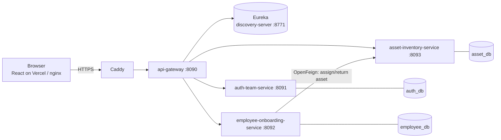

# 03. Architecture

## 1. High-Level Architecture



One PostgreSQL server hosts three databases (database per service). Services register in Eureka; the gateway routes with `lb://` URIs.

## 2. Service Responsibilities

| Service                       | Owns                                                          | Does not do                                                                  |
| :---------------------------- | :------------------------------------------------------------ | :--------------------------------------------------------------------------- |
| `discovery-server`            | Service registry                                              | Business logic                                                               |
| `api-gateway`                 | Routing, CORS                                                 | JWT validation (it forwards the `Authorization` header)                      |
| `auth-team-service`           | Users, passwords, roles, JWT issuing                          | Employees or assets                                                          |
| `employee-onboarding-service` | Employees, onboarding tasks, task rules, onboarding dashboard | Asset stock                                                                  |
| `asset-inventory-service`     | Assets, assignment state, history, stock summary              | Employees (it stores only the employee id and name given at assignment time) |

## 3. Gateway Routing

| Path                                      | Service                       |
| :---------------------------------------- | :---------------------------- |
| `/api/auth/**`, `/api/users/**`           | `auth-team-service`           |
| `/api/employees/**`, `/api/onboarding/**` | `employee-onboarding-service` |
| `/api/assets/**`                          | `asset-inventory-service`     |

## 4. Security and JWT

1. Login returns an HS256 JWT. Claims: `sub` (user id), `email`, `role`, `fullName`, `iat`, `exp`.
2. The gateway only routes and handles CORS (origins from `CORS_ALLOWED_ORIGINS`). It never validates tokens.
3. Every business service validates the JWT itself with the shared `JWT_SECRET` (at least 32 bytes) and applies role rules with method security. Missing or invalid token gives 401, wrong role gives 403 (both with the standard JSON error).
4. OpenFeign calls forward the caller's `Authorization` header, so the asset service applies the same role rules to calls that originate from the employee service.
5. Public endpoints: `POST /api/auth/register`, `POST /api/auth/login`, Swagger UI, `/actuator/health`, `/actuator/info`.

## 5. Key Flows

### 5.1 Create employee

1. HR calls `POST /api/employees`.
2. The service saves the employee, sets `employeeCode` (`EMP-0001`) and creates the checklist from a template in one transaction.

### 5.2 Assign an asset to an equipment task (cross-service, no distributed transaction)

1. IT calls `POST /api/onboarding/tasks/{taskId}/assign-asset` with `assetId`.
2. The employee service validates the task (equipment task, not `DONE`, `assetType` known). **No database transaction is open during the Feign call.**
3. It calls `POST /api/assets/{assetId}/assign` on the asset service. The asset service runs an atomic conditional update (`UPDATE ... SET status='ASSIGNED' WHERE id=? AND status='AVAILABLE'`); zero updated rows means `409`. It also checks that the asset type matches the type sent by the caller.
4. On success the employee service saves the task as `DONE` (asset id, tag and label stored as a snapshot) and recomputes the employee status in a short transaction.
5. If saving fails after the asset was assigned, the service calls `POST /api/assets/{assetId}/return` as a compensation and logs it.
6. Asset service unreachable: `503` and nothing changes.

### 5.3 Employee status

After every task change the employee status is recomputed: all tasks `DONE` gives `ACTIVE` (and `onboardingCompletedAt` is set), any task `IN_PROGRESS` or `DONE` gives `ONBOARDING`, otherwise `PENDING`.

## 6. Error Handling

`@RestControllerAdvice` in every service returns `{timestamp, status, error, message, path}`. Validation errors give 400 (field messages joined), unknown ids 404, rule violations 409, forbidden 403, unexpected errors 500 with a generic message (the stack trace is only logged). `AccessDeniedException` must map to 403, not 500.

## 7. Cross-Cutting Decisions

- Database per service; no cross-database queries.
- Timestamps are stored and sent in UTC (`TZ=UTC` in containers); `LocalDate` for due and joining dates.
- Health checks use `127.0.0.1`, never `localhost`, inside containers.
- Everything is configured by environment variables with safe local defaults.

## 8. Deployment Diagram

```
Vercel (React) ──HTTPS──> Caddy (EC2, ports 80/443)
                              └─> api-gateway ─> auth / employee / asset services
                                   postgres, discovery-server (internal network only)
Docker Hub (images built by GitHub Actions) ──pull──> EC2
```
