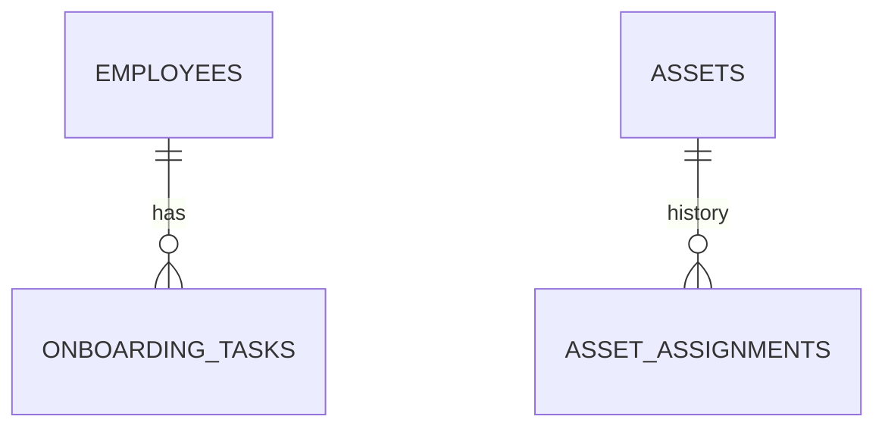

# 04. Database Design

PostgreSQL 16, three databases on one server. Hibernate uses `ddl-auto=update` in the MVP (migration tool is a known limitation). Tests use H2 in PostgreSQL mode.

## 1. ER Overview



Relations across services are by id only (`employee_id` in the asset database, `asset_id` in the employee database), without foreign keys.

## 2. `auth_db`

```sql
CREATE TABLE users (
    id BIGSERIAL PRIMARY KEY,
    full_name VARCHAR(100) NOT NULL,
    email VARCHAR(150) NOT NULL UNIQUE,
    password_hash VARCHAR(100) NOT NULL,
    role VARCHAR(20) NOT NULL CHECK (role IN ('ADMIN', 'HR', 'IT', 'EMPLOYEE')),
    created_at TIMESTAMP NOT NULL DEFAULT CURRENT_TIMESTAMP
);
```

## 3. `employee_db`

```sql
CREATE TABLE employees (
    id BIGSERIAL PRIMARY KEY,
    employee_code VARCHAR(20) UNIQUE,
    full_name VARCHAR(100) NOT NULL,
    email VARCHAR(150) NOT NULL UNIQUE,
    department VARCHAR(20) NOT NULL CHECK (department IN
        ('ENGINEERING', 'HR', 'IT', 'FINANCE', 'SALES', 'OPERATIONS')),
    job_title VARCHAR(100) NOT NULL,
    joining_date DATE NOT NULL,
    status VARCHAR(20) NOT NULL DEFAULT 'PENDING'
        CHECK (status IN ('PENDING', 'ONBOARDING', 'ACTIVE')),
    onboarding_completed_at TIMESTAMP,
    created_by_name VARCHAR(100),
    created_at TIMESTAMP NOT NULL DEFAULT CURRENT_TIMESTAMP,
    updated_at TIMESTAMP NOT NULL DEFAULT CURRENT_TIMESTAMP
);

CREATE TABLE onboarding_tasks (
    id BIGSERIAL PRIMARY KEY,
    employee_id BIGINT NOT NULL REFERENCES employees(id) ON DELETE CASCADE,
    title VARCHAR(150) NOT NULL,
    category VARCHAR(20) NOT NULL CHECK (category IN
        ('DOCUMENTATION', 'ACCOUNT_SETUP', 'EQUIPMENT', 'ORIENTATION')),
    owner_role VARCHAR(10) NOT NULL CHECK (owner_role IN ('HR', 'IT')),
    status VARCHAR(20) NOT NULL DEFAULT 'TODO'
        CHECK (status IN ('TODO', 'IN_PROGRESS', 'DONE')),
    due_date DATE NOT NULL,
    sort_order INT NOT NULL,
    asset_type VARCHAR(20),
    asset_id BIGINT,
    asset_tag VARCHAR(20),
    asset_label VARCHAR(150),
    completed_at TIMESTAMP,
    completed_by_name VARCHAR(100),
    created_at TIMESTAMP NOT NULL DEFAULT CURRENT_TIMESTAMP,
    updated_at TIMESTAMP NOT NULL DEFAULT CURRENT_TIMESTAMP
);

CREATE INDEX idx_employees_status ON employees(status);
CREATE INDEX idx_employees_department ON employees(department);
CREATE INDEX idx_tasks_employee ON onboarding_tasks(employee_id);
CREATE INDEX idx_tasks_status_due ON onboarding_tasks(status, due_date);
```

`employee_code` is set to `EMP-` plus the id padded to 4 digits (for example `EMP-0012`) right after the insert.

## 4. `asset_db`

```sql
CREATE TABLE assets (
    id BIGSERIAL PRIMARY KEY,
    asset_tag VARCHAR(20) UNIQUE,
    type VARCHAR(20) NOT NULL CHECK (type IN
        ('LAPTOP', 'MONITOR', 'KEYBOARD', 'MOUSE', 'HEADSET', 'MOBILE')),
    make VARCHAR(60) NOT NULL,
    model VARCHAR(80) NOT NULL,
    serial_number VARCHAR(80) NOT NULL UNIQUE,
    status VARCHAR(20) NOT NULL DEFAULT 'AVAILABLE'
        CHECK (status IN ('AVAILABLE', 'ASSIGNED', 'IN_REPAIR', 'RETIRED')),
    purchase_date DATE,
    assigned_employee_id BIGINT,
    assigned_employee_name VARCHAR(100),
    assigned_at TIMESTAMP,
    created_at TIMESTAMP NOT NULL DEFAULT CURRENT_TIMESTAMP,
    updated_at TIMESTAMP NOT NULL DEFAULT CURRENT_TIMESTAMP
);

CREATE TABLE asset_assignments (
    id BIGSERIAL PRIMARY KEY,
    asset_id BIGINT NOT NULL REFERENCES assets(id) ON DELETE CASCADE,
    employee_id BIGINT NOT NULL,
    employee_name VARCHAR(100) NOT NULL,
    assigned_by_name VARCHAR(100),
    assigned_at TIMESTAMP NOT NULL DEFAULT CURRENT_TIMESTAMP,
    returned_at TIMESTAMP,
    returned_by_name VARCHAR(100)
);

CREATE INDEX idx_assets_type_status ON assets(type, status);
CREATE INDEX idx_assignments_asset ON asset_assignments(asset_id);
```

`asset_tag` is a type prefix (`LAP`, `MON`, `KEY`, `MOU`, `HEA`, `MOB`), a dash and the id padded to 4 digits (for example `LAP-0007`).

## 5. Rules enforced in the database

- Unique `users.email`, `employees.email`, `assets.serial_number`, `assets.asset_tag`, `employees.employee_code`.
- Check constraints on every enum column.
- The atomic assignment is a conditional `UPDATE assets SET status='ASSIGNED' ... WHERE id=? AND status='AVAILABLE'`.

## 6. Databases and users

`docker/postgres/01-create-databases.sql` creates `auth_db`, `employee_db` and `asset_db` on the first start of an empty volume.
